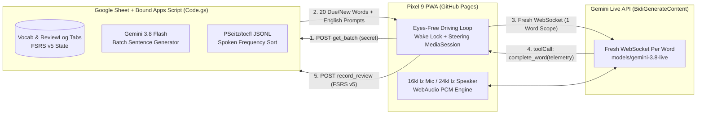

# 台灣華語口說家教 · Hands-Free Taiwanese Mandarin Driving Tutor

A completely hands-free, eyes-free Taiwanese Mandarin vocabulary & conversational sentence tutor designed for your **Pixel 9** while driving or with your eyes closed.

---

## Architecture & How It Solves Context Degradation

1. **Zero Context Degradation:** Instead of holding a single long conversation across 10+ words where audio tokens snowball and the LLM forgets instructions, the deterministic JS controller opens a **fresh Gemini Live WebSocket per word** (`models/gemini-3.8-live` with automatic fallback to `models/gemini-3.1-flash-live-preview`). The persistent WebAudio context and microphone stream stay open across sockets so Chrome on Pixel 9 never re-prompts for mic permissions or drops Bluetooth audio.
2. **Smart Batch Pre-Generation (`gemini-3.8-flash`):** At the start of a 20-word batch, Apps Script makes a single structured-JSON call to `gemini-3.8-flash` to craft natural, concrete everyday English sentences (and back-fills missing English glosses for TOCFL words), ensuring each review uses a fresh scenario.
3. **4-Phase Conversational Practice Loop (100% Taiwanese Mandarin):**
   - **Phase 1 (Translation & Coaching):** The tutor reads the English prompt out loud, then speaks **100% Taiwanese Mandarin** (`繁體中文`, Taiwan terms & tone pronunciations) to coach your pronunciation, tones, and grammar until you produce the full Mandarin sentence with the target word. Valid synonyms (e.g. `餐廳` for `餐館`) trigger a friendly, penalty-free redirect without spoiling the pronunciation.
   - **Phase 2 (Tutor Follow-Up Question):** Once you say the sentence correctly, the tutor affirms and asks a natural follow-up question in Mandarin continuing the topic.
   - **Phase 3 (Your Reply + Counter-Question):** You reply in Mandarin and ask a question back (if you forget to ask a question, the tutor prompts you to ask one).
   - **Phase 4 (Tutor Answer + Auto-Advance):** The tutor answers your question and immediately calls `complete_word(...)`, triggering a chime and transitioning to the next word.
4. **Hybrid 1–4 Scoring + FSRS v5:** The LLM reports objective facts (`target_word_recalled`, `needed_hint`, `pronunciation_attempts`, `grammar_errors`, `conversation_fluency`), and deterministic code computes the 1–4 score and updates FSRS v5 `stability`, `difficulty`, and `due_date` in your Google Sheet.
5. **20-Word Batch Mix & Vocab Sourcing:**
   - Defaults to **20 words per batch**, targeting **10% new words** (18 due reviews + 2 new words), and **automatically fills any remaining slots with new words** if fewer than 18 words are due for review.
   - Prioritizes new words imported from your **Hanping Chinese Dictionary CSV export**, and automatically supplements from [`PSeitz/tocfl`](https://github.com/PSeitz/tocfl) (`tocfl_words.json`) at your target TOCFL level sorted by **`spoken_per_million` descending**.

---

## 5-Minute Setup Guide

### Step 1: Set Up Your Google Sheet & Bound Apps Script
1. Create a new Google Sheet at [sheets.new](https://sheets.new) and name it **Mandarin Tutor SRS**.
2. Click **Extensions → Apps Script**.
3. Replace the contents of `Code.gs` with [`apps-script/Code.gs`](./apps-script/Code.gs) and press **Save** (`Ctrl+S` / `Cmd+S`).
4. In the Apps Script left sidebar, click **Project Settings (⚙️)** → scroll down to **Script Properties** → click **Add script property** and add two properties:
   - `GEMINI_API_KEY`: Your API key from [Google AI Studio](https://aistudio.google.com/apikey) (linked to your Google AI Pro account / project).
   - `BACKEND_SECRET`: Any personal secret passphrase of your choice (e.g. `my-pixel9-taiwan-secret-2026`).
5. In the Apps Script top bar, select `setupSheet` from the function dropdown and click **Run** once (grant the permissions prompt so your script can read/write your Sheet and call Gemini + GitHub).
6. Click **Deploy → New deployment**:
   - **Select type:** `Web app`
   - **Execute as:** `Me`
   - **Who has access:** `Anyone` *(Security note: Every request is verified against your `BACKEND_SECRET` in `Code.gs`, and `Anyone` allows cross-origin `text/plain` POST requests from your GitHub Pages PWA without OAuth popups).*
   - Copy the resulting **Web app URL** (`https://script.google.com/macros/s/.../exec`).

### Step 2: Host the Frontend on GitHub Pages
1. Push this repository to GitHub (public repository is fine — zero secrets or personal data are in the repo).
2. In your GitHub repository, go to **Settings → Pages** and set **Source** to deploy from the `main` branch (`/` root).
3. Open your GitHub Pages URL in **Chrome on your Pixel 9**, tap Chrome's menu (**⋮**) → **Add to Home screen / Install app**.

### Step 3: Connect & Import Hanping Vocab
1. Open the installed app on your Pixel 9, tap **設定 (Settings)** in the top right, and paste:
   - Your **Apps Script Web App URL**
   - Your **`BACKEND_SECRET`**
   - Tap **儲存設定 · Save**.
2. Tap **詞庫同步 (Sync Vocab)** to upload your **Hanping CSV export** or click **Supplement from PSeitz/tocfl** to pre-load high-frequency spoken Taiwanese Mandarin words for your TOCFL level.
